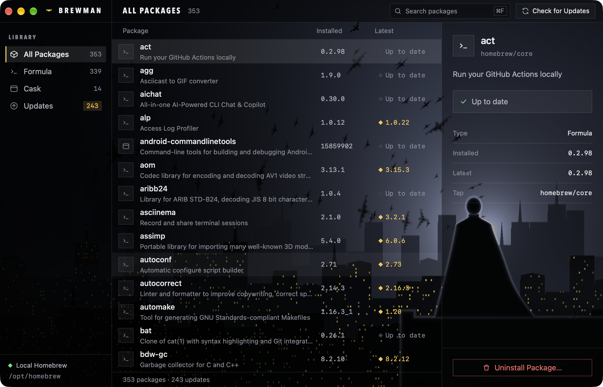

# Brewman

A native macOS app for managing Homebrew packages, built with [NSH](https://nsh.dev). A dark “night watch” interface: a live
shader night sky with bats behind translucent panels, sharp corners and a single gold accent.



[Website](https://huacnlee.github.io/brewman/) · [Download](https://github.com/huacnlee/brewman/releases) · [中文](https://huacnlee.github.io/brewman/zh-CN/)

- Lists every installed formula and cask, with the installed and latest versions side by side.
- Filters by All / Formula / Cask / Updates, and searches by name (⌘F).
- Inspector with description, tap, versions and dependencies.
- Upgrades a package, checks for updates (`brew update` and `brew outdated`), and uninstalls after a confirmation.
- Right-click a row for Upgrade and Uninstall.
- English and Simplified Chinese, following the system language (English by default).
- Native AppKit views; the backdrop is a GPU shader that holds still when Reduce Motion is on.

## Install

macOS on Apple silicon or Intel, with [Homebrew](https://brew.sh) installed.

```sh
curl -fsSL https://huacnlee.github.io/brewman/install.sh | sh
```

This downloads the latest release, verifies its SHA-256 checksum and installs `Brewman.app` into `~/Applications`. Run it
again to upgrade. Options:

```sh
curl -fsSL https://huacnlee.github.io/brewman/install.sh | sh -s -- --version v0.1.0   # a specific release
curl -fsSL https://huacnlee.github.io/brewman/install.sh | sh -s -- --dir /Applications # another folder
```

To remove it, quit Brewman and delete `~/Applications/Brewman.app`.

## Development

Brewman is a TSX app on NSH (no Rust of its own). Install the `nsh` CLI from [nsh.dev](https://nsh.dev/docs/installation),
then:

```sh
nsh run        # run with hot reload
nsh check      # type check
nsh build      # bundle
nsh test       # headless UI tests
```

- `App.tsx`: the window: title bar, sidebar, package table, inspector, uninstall dialog.
- `src/brew.ts`: runs `brew` and parses its JSON.
- `src/ui/`: the app's styled controls, icons, motion tokens, the title bar and the `NightScene` shader.
- `locales/`: UI text, `en.yml` and `zh-CN.yml` (read with `t()` from `nsh/i18n`).
- `theme.json`: color tokens. `DESIGN.md`: design rules and the motion inventory.
- `website/`: the [project website](https://huacnlee.github.io/brewman/), which also serves `install.sh`.

### Release

Push a `v*` tag. `.github/workflows/release.yml` packages `Brewman.app` on Apple silicon and Intel runners with
`scripts/build-release.sh`, then publishes the archives and `SHA256SUMS` as a GitHub Release. Locally:
`scripts/build-release.sh 0.1.0` writes `.nsh/dist/brewman-v0.1.0-<arch>-apple-darwin.tar.gz`.

## License

MIT. The bats, skyline, figure and app icon are original artwork.
